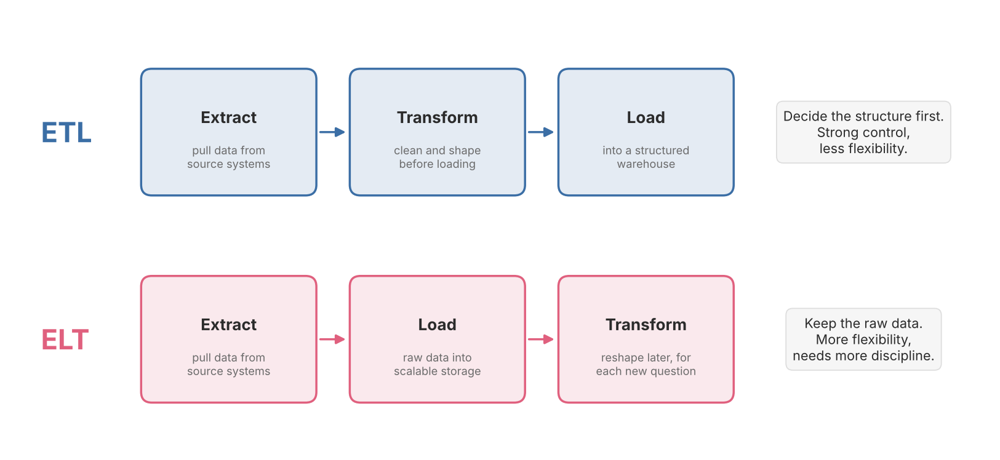

When I first learned how data moved through organisations, ETL made complete sense.

You extracted data from source systems, transformed it into a clean, consistent structure, and then loaded it somewhere safe for reporting and analysis. The logic felt disciplined and reassuring. Decisions about structure, quality, and meaning were made upfront, before the data reached anyone who might use it.

In many ways, ETL reflected how organisations wanted data to behave: controlled, predictable, and ready for consumption.

And for a long time, that approach worked remarkably well.

## Why ETL was the right answer

Traditional ETL pipelines were designed for a world where data volumes were manageable and questions were relatively stable. Reports were known in advance. Metrics were agreed upfront. Data models were built to support specific business processes.

Transforming data before loading it came with real benefits. Quality checks happened early. Schemas enforced consistency. Downstream users could trust that the data they were working with had already been validated and shaped for purpose.

ETL wasn’t just a technical pattern — it was a way of protecting the business from ambiguity.

  

    
  

## Where the cracks began to show

As data volumes grew and sources multiplied, that sense of certainty started to erode.

New datasets arrived faster than models could be designed. Business questions evolved mid-project. Data that was prepared for one purpose was suddenly expected to serve another. The upfront decisions baked into ETL pipelines became constraints rather than safeguards.

The problem wasn’t that ETL was flawed. It was that it assumed we could decide, early on, what the data would be used for.

In practice, understanding often comes after exploration, not before it.

## When transformation moved downstream

This shift in reality is what gave rise to ELT.

Instead of transforming data before loading it, ELT flips the order. Raw data is extracted and loaded first, usually into scalable storage. Transformations then happen later, closer to the point of analysis and driven by the questions being asked at that moment.

The appeal is obvious. By delaying transformation, you preserve flexibility. Data can be reshaped multiple times for different use cases. New questions don’t require rebuilding the entire pipeline. Analysts and data scientists gain more autonomy over how data is interpreted.

In big data environments, where storage is cheap and compute is elastic, this model fits naturally.

  

    
  

## The trade-offs ELT introduces

ELT is often presented as a modern replacement for ETL, but that framing misses something important.

ELT doesn’t remove complexity — it redistributes it.

Quality checks move downstream. Governance becomes harder to enforce centrally. The responsibility for transformation shifts closer to the people analysing the data, which requires stronger discipline, better documentation, and clearer conventions.

Without care, ELT can turn flexibility into inconsistency.

This is why the move from ETL to ELT isn’t really a technical upgrade. It’s a change in how decisions are made, and when they’re made.

---

## In practice: saving the raw data first

My [airline review sentiment project](/project/sentiment-analysis) follows the ELT idea on a small scale. The pipeline downloads each airline's review page and saves the raw HTML locally before extracting anything from it. Only then does a separate step pull out the titles, ratings and review text.

That choice paid off more than once. When I changed how the text was cleaned, or how sentiment was scored, I could rerun the analysis on the saved pages without sending a single new request to the website. The raw data stayed untouched, and each new question became a new transformation rather than a new collection.

---

## What this shift taught me

Learning ETL first gave me an appreciation for structure and intentionality. It forced me to think carefully about schemas, definitions, and edge cases before anything went live.

ELT, on the other hand, taught me humility.

It accepted that we don’t always know the right structure upfront. That understanding evolves through exploration. That locking decisions too early can limit insight rather than enable it.

In that sense, the shift mirrors how we learn to work with data more broadly. Start by making things visible. Explore. Question. Then introduce structure once the logic is clear.

---

## Closing thought

ETL didn’t become obsolete. It stopped being the default.

In a world where data is larger, messier, and used in more unpredictable ways, delaying transformation isn’t a lack of rigour — it’s an acknowledgement that understanding takes time.

Sometimes the most important decision is recognising when not to decide yet.

---

## Key takeaways

- ETL transforms data before loading it: strong control, less flexibility.
- ELT loads raw data first and transforms it later: more flexibility, but quality and governance need more discipline.
- Keeping the raw data lets you answer new questions without collecting everything again.

