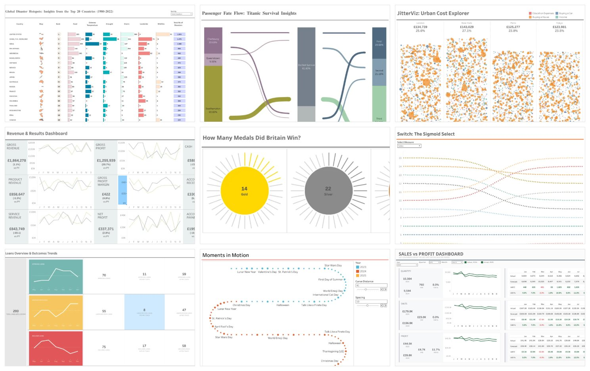

I never sat down and chose a path in data science. I took the next step that made sense, three times, and each step showed me what the next one should be.

If you are trying to decide between analytics, engineering and machine learning, here is what I have learned from moving through them, and what I would tell anyone starting out.

## The three main paths, in plain terms

Job titles vary, but most data roles sit somewhere on this map:

- **Data analytics:** answering business questions with data. Think SQL, dashboards in tools like Tableau or Power BI, and explaining results to people who do not live in spreadsheets.
- **Data engineering:** building the pipelines and platforms that move data reliably from where it is created to where it is used. Think SQL, cloud platforms and orchestration tools such as Airflow or Prefect.
- **Machine learning and data science:** building models that predict, classify or find patterns. Think Python, statistics, scikit-learn or TensorFlow, and a lot of experimenting.

They overlap more than the titles suggest. The best analysts understand pipelines, and the best data scientists can explain their results simply.

## Step 1: Learning to answer questions

My first step was a Level 4 Data Analyst apprenticeship, which I completed with a Distinction.

This is where I learned the fundamentals that everything else rests on: cleaning messy data, writing queries, and turning a vague request into a question the data can answer. The most important lesson was not technical. A correct analysis that answers the wrong question is still the wrong answer.

## Step 2: Learning to communicate

Next I moved into business intelligence, building Tableau dashboards and reports for stakeholders around the world.

BI taught me that a dashboard is only as good as the decision it supports. It also taught me something I did not expect: one of the most valuable parts of my role is deciding which reports **not** to build. Every request reveals a question, and sometimes the best answer is an existing report, a single number or a short conversation rather than a new dashboard.

  

    
  

## Step 3: Learning to predict

The third step was a Level 6 Data Science degree apprenticeship, a three-year programme I completed alongside my job.

This is where I moved from describing what happened to predicting what might happen next: neural networks for employee attrition, NLP on airline reviews and shipment notes, time-series forecasting on a century of temperature data, and an [early warning model for air cargo delays](/project/early-warning-air-cargo-delays/) as my final project. You can see all of them on my [projects page](/projects/).

The biggest surprise was how much my earlier steps mattered. Knowing how the business works told me which features to build. Knowing how to communicate meant the results were actually used.

## What I would tell someone starting out

**Start with the fundamentals.** SQL, data cleaning and clear communication are useful on every path. They are never wasted.

**Try small projects in each area.** Build a simple dashboard, a small pipeline and a basic model. Notice which one you lose track of time doing. That is a better guide than any salary table.

**Consider an apprenticeship.** Learning while working meant every concept had a real problem to attach to, and I could apply new skills at work the following week.

**Don't treat your first choice as final.** People move from analytics to engineering, from engineering to machine learning, and back again. The field rewards curiosity more than a perfect plan.

## Closing thought

Choosing a path in data is less about predicting the future and more about noticing which problems you enjoy solving. Mine went from answering questions, to communicating answers, to predicting what comes next, and each step made me better at the one before.

---

## Key takeaways

- Analytics, engineering and machine learning overlap: the fundamentals transfer between all three.
- Small projects in each area are the fastest way to find out what you enjoy.
- Your first step does not have to be your final one.
