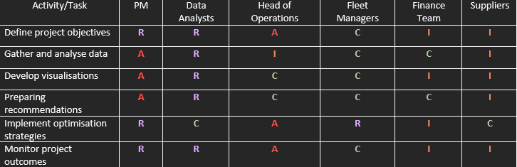
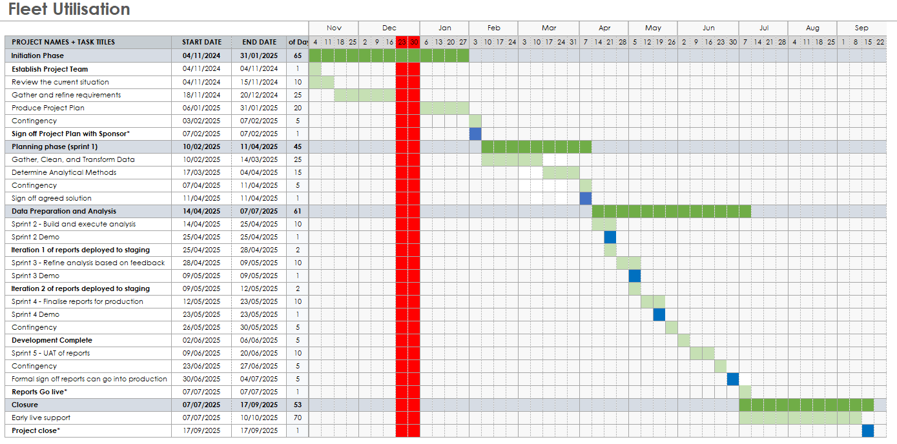

Most data projects that fail do not fail because of the model. They fail because nobody agreed what the model was for, the right people were not involved, or the scope kept growing until the deadline arrived first.

I learned this by planning a project before writing a single line of code. For my [fleet performance project](/project/fleet-performance-forecasting), I took on the project manager role and wrote the full plan first: the business case, the scope, the stakeholders, the schedule and the risks. This post walks through that plan, and what each tool taught me about the human side of data work.

  

    
  

## Setting the direction: turning a broad question into a clear goal

The project started with a familiar business question: is it cheaper to run our own trucks or to use a supplier? Everyone agreed it mattered, but "look at the fleet" is not something a team can deliver.

So the first step was to make it concrete. The goal became identifying underused vehicles, so the operations team could compare the cost of keeping each truck against using a supplier, with a target of a 15% improvement in fleet management within 12 months.

Just as important was deciding what was **out** of scope. How full each truck is and whether it earns more than it costs were in. Driver performance, new customers and maintenance schedules were out. Data projects tend to grow as soon as the first insights appear, and an agreed scope gives everyone a reference point when enthusiasm starts turning into scope creep.

> The great enemy of communication, we find, is the illusion of it.
> <cite>William H. Whyte</cite>

## Stakeholders: the human layer beneath the data

People come to a data project with different levels of data literacy, different expectations of what analysis can do, and different pressures on their time.

I mapped the stakeholders on a power–interest grid, from the Head of Operations as sponsor to fleet managers, the finance team and suppliers. The grid shows who needs close involvement and who mainly needs to be kept informed, but it is only a starting point. The real value comes from ongoing conversations: translating technical constraints into business language, turning operational concerns into clear requirements, and making sure everyone has a realistic picture of what the data can and cannot answer.

A RACI matrix then set out who is **R**esponsible, **A**ccountable, **C**onsulted and **I**nformed at each stage. It is not box-ticking. When everyone knows who owns a decision, work moves faster and fewer things fall between the gaps.

  

    
  

---

## Planning: making time visible

A Gantt chart is often treated as a timeline. I found it more useful as a communication tool. It makes dependencies visible, shows the milestones that matter, and lets stakeholders see what happens to the end date if something earlier slips. Abstract dates become something concrete that people can discuss.

The plan also covered resources: access to systems, software and data arranged ahead of time, so the team could spend its time on analysis rather than waiting for permissions.

  

    
  

---

## Methodology: Waterfall and Agile, each at the right moment

No data project fits neatly into one delivery method, so the plan used both.

The start was Waterfall: defining scope, securing access, agreeing deliverables and setting expectations. These are decisions that should be made once, early and clearly.

The analysis itself was planned as Agile sprints. Exploratory work rarely goes exactly as expected: assumptions get tested, patterns emerge and priorities shift. Each sprint ended with a demo, so stakeholders could see progress and steer the next step instead of waiting months for a final report.

---

## Risk: staying ahead of surprises

The plan included a risk register scored by likelihood and impact. The two highest risks were inaccurate data and stakeholders drifting out of alignment, and each had a named owner and a mitigation: validating the data early, and regular updates with written confirmation of decisions. Five weeks of contingency were built into the schedule.

Risk management in data projects is less about avoiding every problem and more about seeing problems early and having a plan ready when they arrive.

---

## What this taught me

Managing data work is a balance: structure and flexibility, tools and empathy, planning and adaptability.

- A Gantt chart is not just a timeline. It is a communication device.
- A RACI matrix is not just a diagram. It prevents misunderstandings.
- A stakeholder map is not just a visual. It helps build relationships.
- A risk register is not just a form. It is a mindset.

Data projects succeed not because of the tools we use, but because of how well we bring people together around a shared goal. You can see the plan, and the app it led to, on the [fleet performance project page](/project/fleet-performance-forecasting).

---

## Key takeaways

- Turn a broad business question into a specific, measurable goal, and agree what is out of scope.
- Map stakeholders early and keep talking to them: the grid is the start, not the work.
- Use structured planning for the set-up and short, demo-led sprints for the analysis.
