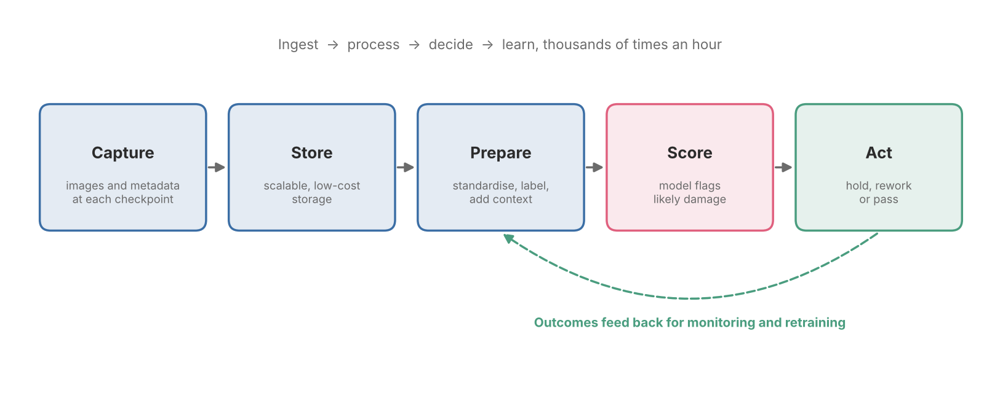

Ever wondered what really happens to a parcel between the picking station and the lorry door in a busy warehouse? In high-throughput environments, thousands of items move past cameras, scanners, and sensors every hour. The challenge isn’t a lack of data — it’s volume, speed, and coordination. This is a big data problem first, with machine learning acting as an enabler rather than the starting point.

This post is a solution design: how I would approach automated damage detection at scale, layer by layer. It is not a description of a system I have deployed, and it is written to be useful to anyone thinking through a similar problem.

At scale, quality improves only when large volumes of operational data can be captured, processed, and acted on fast enough to influence decisions on the floor.

*Quality isn’t just an audit at the end with the right data flows, it becomes a real-time intervention.*

## The core idea, without the buzzwords

The solution relies on treating images and operational events as part of a continuous data stream rather than isolated inspections:

* Capture images and metadata at key points in the flow (inbound, packing, outbound).

* Store them efficiently in a scalable data layer designed for high-volume retention.

* Prepare inputs through automated pipelines — standardising formats, managing labels, and enriching records with operational context.

* Score each record using trained models to identify likely damage.

* Act directly in the workflow: hold, rework, or pass.

* Feed outcomes back into the data pipeline to support learning and retraining.

Seen end-to-end, this is a data lifecycle problem: ingest, process, decide, learn — repeated thousands of times per hour.

  

    
  

## Where machine learning fits

Computer-vision models — such as modern CNNs or EfficientNet-style architectures — provide the classification capability, but they only add value when embedded in a system that can handle data at scale. Accuracy matters, but so do throughput, latency, and cost per record processed.

In practice, the model is just one component in a much larger data pipeline. The goal is not sophistication for its own sake, but dependable performance under operational load.

*Start small, measure relentlessly, and scale what proves its value.*

## Why real-time data changes the outcome

Traditional batch reporting explains what went wrong after the fact. Streaming data pipelines make it possible to intervene while parcels are still moving.

This enables teams to:

* Detect damage before outbound labelling.

* Divert suspect items before trailer loading.

* Trigger quick re-packs instead of downstream returns.

In most environments, once data is delayed, the cost is already fixed. Big data earns its value when it moves quickly enough to influence decisions in the moment.

## A scalable data architecture (four practical layers)

#### Ingest & Store
High-volume image data and operational metadata land in durable, low-cost storage. The emphasis is on throughput and retention, not tight coupling to compute.

#### Prepare & Orchestrate
Automated pipelines validate, transform and catalogue data so downstream processing receives consistent, auditable inputs.

#### Process at Scale
Distributed compute handles parallel image processing and inference across large volumes. Elasticity allows the platform to absorb peaks without permanent over-provisioning.

#### Serve & Monitor
Decisions flow back into operational systems. Data quality, latency, model drift and processing cost are monitored continuously, with retraining triggered by changes in inputs or conditions.

This structure keeps the system flexible as data volumes grow.

## Governance and data operations

Big data systems fail quietly without ownership and controls. Reliability comes from discipline:

* Version datasets, features and models.

* Track experiments and data lineage.

* Automate deployments with rollback paths.

* Define expectations for latency, availability and response.

* Measure outcomes that reflect data value: false-negative reduction, alert speed, and cost per item processed.

This is where data engineering, analytics and machine learning meet operations.

## Cost, scale and sustainability

Effective big-data systems scale elastically. Usage-based compute, scale limits and automated shutdowns prevent cost surprises. As workloads stabilise, baseline capacity can be reserved to improve efficiency.

In practice, simpler pipelines that move data quickly often outperform complex architectures that struggle under volume.

## Risks — and how data design reduces them

* **Data drift**: monitor input distributions and outcomes; retrain on schedule and on trigger.

* **Skewed datasets**: diversify images across lighting, packaging and handling conditions.

* **Operational gaps**: define clear ownership across data, models and workflows.

* **Adoption friction**: keep feedback loops simple and embedded in existing tools.

## A 90-day data-first rollout

#### Weeks 1–3
Stand up ingestion, validate data flows, label a representative dataset, and baseline key metrics.

#### Weeks 4–6
Train an initial model, integrate human review, and monitor pipeline performance under load.

#### Weeks 7–12
Enable targeted real-time processing, tune thresholds, introduce drift monitoring, and optimise cost.

If performance stalls, the constraint is usually upstream data quality or latency, not the model itself.

## Closing thought

Automated damage detection at scale is fundamentally a big-data challenge. When large volumes of images and events can be captured, processed and acted on in real time, quality becomes proactive rather than reactive. With the right data foundations in place, machine learning becomes a natural extension, not the starting point.

---

## Key takeaways

- Treat image detection as a data pipeline first and a model second.
- Measure what the business feels: missed damage, alert speed and cost per item, not just model accuracy.
- Start small, monitor drift, and feed real outcomes back into retraining.

