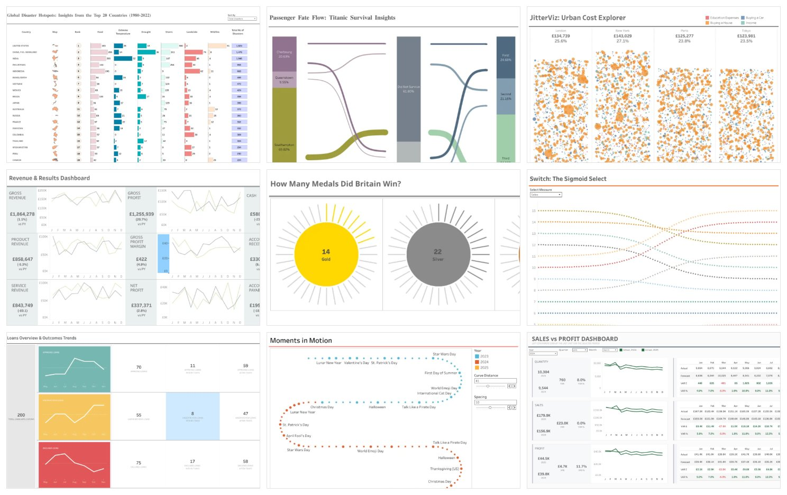
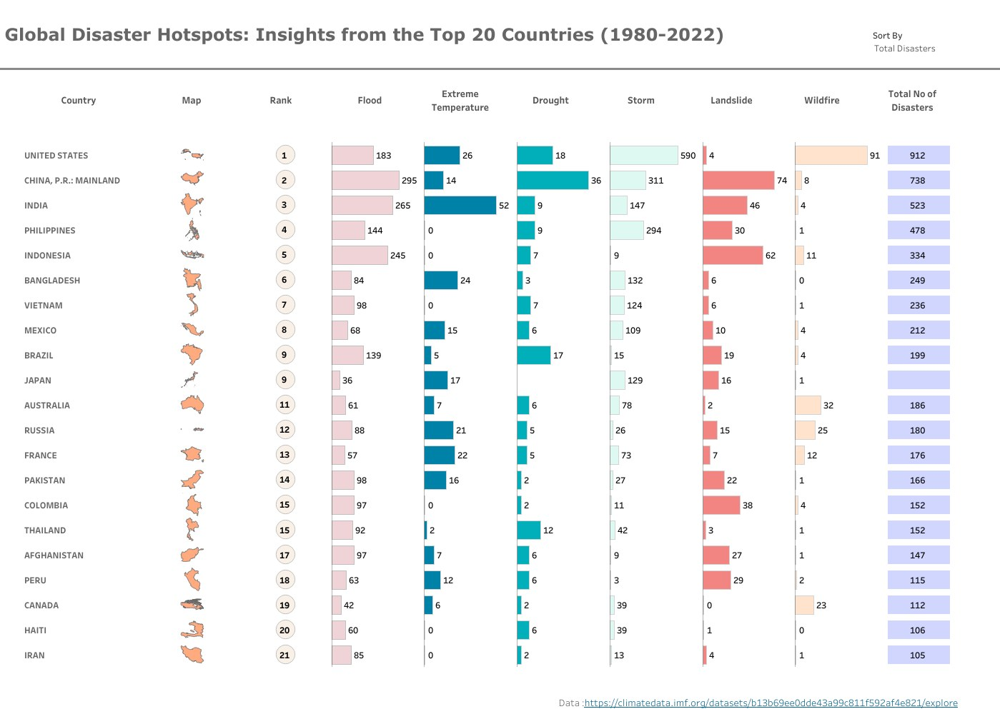
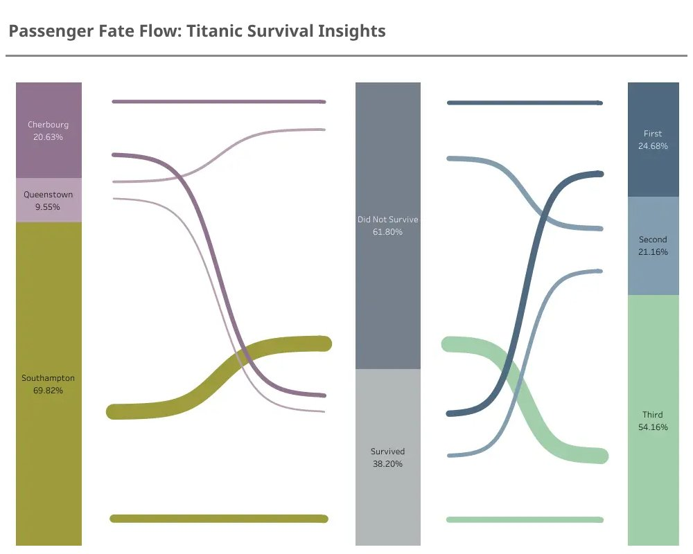
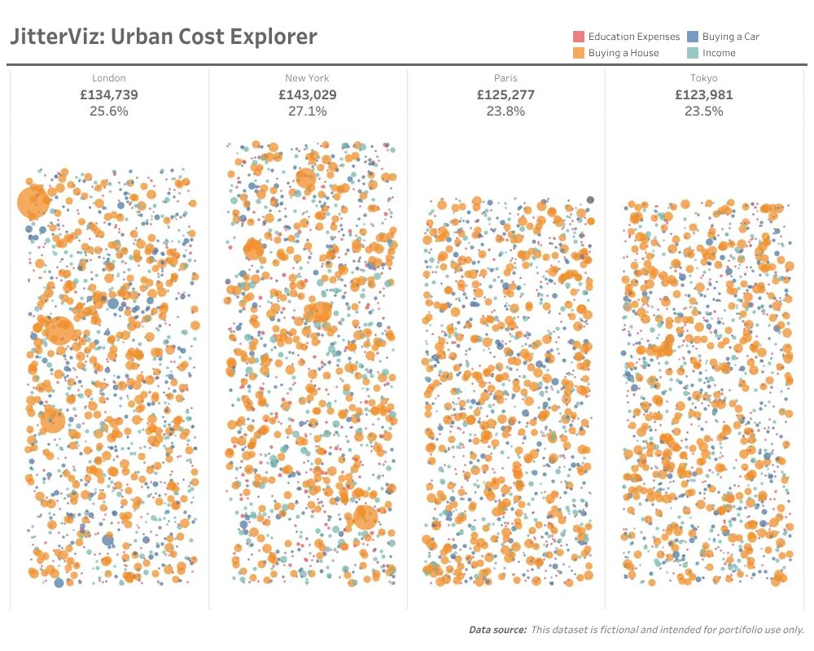

## At a glance

- **Problem:** Turn data into visuals people can understand in seconds.
- **Data:** Public and fictional datasets, from IMF climate-disaster records to the Titanic passenger list.
- **Approach:** Start from the question and the audience, choose the chart that fits the data, and remove anything that does not help the reader.
- **Result:** A collection of interactive dashboards on Tableau Public, each trying out a different technique.
- **Tools:** Tableau Public

---

## Why visualisation matters

Most decisions based on data are made by people who will never see the code behind it. For them, the chart is the analysis. If it takes more than a few seconds to see the answer, or if the design suggests something the data does not support, the work behind it is lost.

Building dashboards is a large part of my day-to-day work, and it has shaped a simple rule: every visual should answer a clear question for a specific person. This page shows how I apply that rule in my personal Tableau Public projects, where I also try out chart types and techniques beyond the standard bar and line chart.

  

    
  

---

## My approach

Each dashboard starts with the same four questions:

- **What question does it answer?** If I cannot write it in one sentence, the dashboard is not ready to build.
- **Who is it for?** An executive needs the headline first; an analyst needs room to explore.
- **Which chart fits the data?** Rankings, flows, distributions and trends each have a chart that shows them best. The chart is chosen for the data, not for variety.
- **What can be removed?** Gridlines, extra colours and labels that repeat the axis all compete for attention. Each element has to earn its place.

Interactivity follows the same rule. Filters, parameters and tooltips are added only when they help someone answer a follow-up question, and every dashboard should make sense before anyone clicks on it.

---

## Global Disaster Hotspots

**The question:** which countries are most affected by climate-related disasters, and what kind of disasters do they face?

**Who it's for:** a general audience, such as readers of a news article or a policy briefing, who want to compare countries quickly.

  

    
  

Using IMF climate data from 1980 to 2022, the dashboard ranks the most affected countries and breaks each country's total down by disaster type: flood, extreme temperature, drought, storm, landslide and wildfire.

**Design choices:**

- **A table of bars instead of a stacked chart.** Each disaster type has its own column and colour, so every type can be compared down the column on the same starting line. In a stacked bar, only the first segment shares a baseline.
- **Small country maps** next to each name, so the reader recognises the country at a glance.
- **A "Sort By" control** that re-ranks the table by any disaster type. The same view answers "who has the most storms?" and "who has the most droughts?" without a second dashboard.

The view makes the differences between countries clear. Storms are the most common disaster in the United States, China and the Philippines, floods in India and Indonesia, and China also has the most landslides and droughts among the top countries.

**[Explore Global Disaster Hotspots](https://public.tableau.com/app/profile/jessica.di.monaco/viz/GlobalDisasterHotspots/Dashboard)**

---

## Titanic Survival Insights

**The question:** how did a passenger's port of embarkation and ticket class relate to whether they survived?

**Who it's for:** anyone learning about the Titanic, and a way to show that a flow chart can tell a story a table cannot.

  

    
  

The dashboard is a Sankey chart. Passengers flow from where they boarded, through whether they survived, to the class they travelled in. Most passengers boarded at Southampton (70%), 62% did not survive, and over half travelled in third class (54%).

**Design choices:**

- **A flow chart for a journey.** The data describes stages a passenger moved through, so the chart follows the same path from left to right. The thickness of each band shows how many passengers took that route.
- **Survival in the middle.** Placing the outcome at the centre links both questions to it: where people boarded, and which class they travelled in.
- **Muted, related colours** for each stage, so the shape of the flows stands out rather than the colours.

Following the bands answers the question directly: the thick band from "did not survive" leads mainly to third class, while survivors are spread more evenly across the classes.

**[Explore Titanic Survival Insights](https://public.tableau.com/app/profile/jessica.di.monaco/viz/TitanicSurvivalInsights/TitanicSurvival)**

---

## JitterViz: Urban Cost Explorer

**The question:** how do the big costs of city life, such as buying a home, buying a car and education, compare between London, New York, Paris and Tokyo?

**Who it's for:** someone weighing up a move between cities, who wants to see the full spread of costs rather than a single average.

  

    
  

Each dot is a single transaction. Its colour shows the category (buying a house, buying a car, education or income) and its size shows the value. Above each city is a headline figure and its share across the four cities. Hovering on a dot shows the details of that transaction. The dataset is fictional and was created for this portfolio.

**Design choices:**

- **A jitter plot to show the whole distribution.** An average hides the spread. Scattering the points sideways stops thousands of transactions from sitting on top of each other, so the reader can see both the typical cost and the outliers.
- **Size for value, colour for category.** The large orange dots stand out immediately, showing that buying a house drives the biggest costs in every city.
- **Side-by-side columns on the same scale**, so the cities can be compared directly.

**[Explore JitterViz: Urban Cost Explorer](https://public.tableau.com/app/profile/jessica.di.monaco/viz/JitterVizUrbanCostExplorer/Dashboard)**

---

## Other techniques in the collection

The rest of the collection uses Tableau to try out a different technique in each dashboard:

- **Switch The Sigmoid Select:** a bump chart with curved, sigmoid lines that shows how countries change rank, with a control to switch the measure.
- **How Many Medals Did Britain Win?:** a radial design that turns the gold, silver and bronze medal tally into sunburst-style circles.
- **Moments in Motion:** a winding path of calendar events across three years, with sliders that change the curve and spacing of the layout.
- **Revenue & Results** and **Sales vs Profit:** business dashboards that pair headline KPIs with year-on-year change and monthly trend lines.
- **Loans Overview & Outcomes Trends:** a status overview of approved, pending and declined loans, each with its own trend.

---

## What this shows

- **The question comes first.** Each dashboard is built around one clear question and one audience.
- **The chart is chosen for the data.** Rankings, journeys and distributions each get the chart that shows them most honestly.
- **Less is clearer.** Removing what does not help the reader is as important as what is added.

My thinking on this is set out in more detail in the blog post **[From Data to Decisions: My Visualisation Approach](/blog/from-data-to-decisions-my-visualisation-approach)**.

---

## Explore the dashboards

All the dashboards are interactive and can be explored on Tableau Public:

**[View my Tableau Public profile](https://public.tableau.com/app/profile/jessica.di.monaco/vizzes)**
