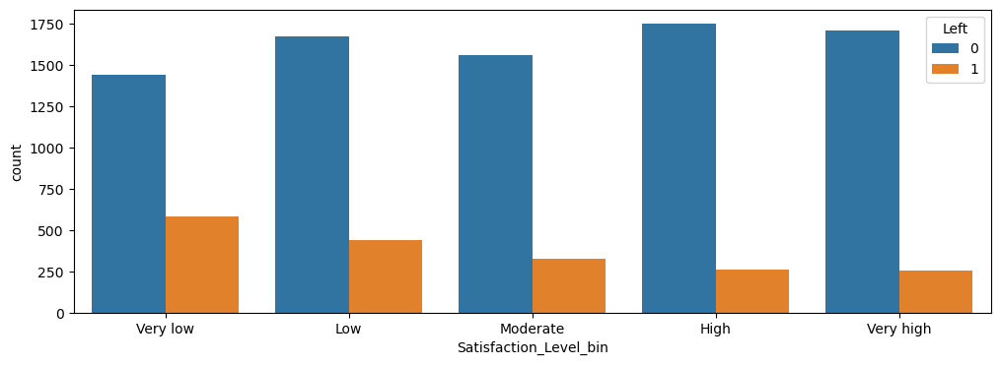
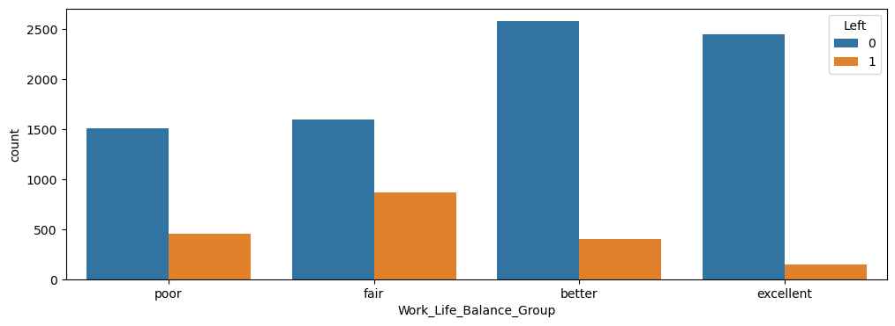
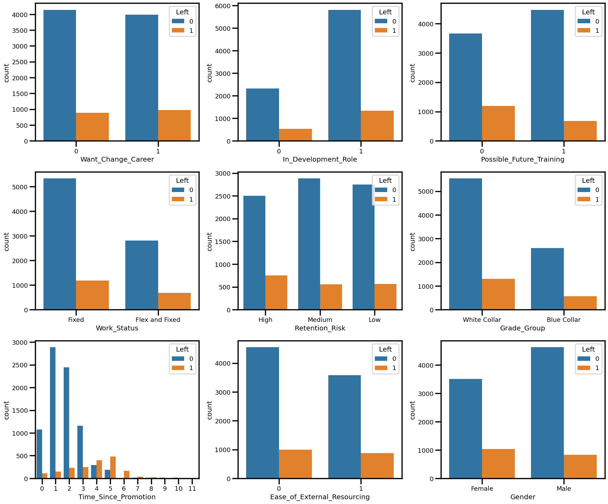

## At a glance

- **Problem:** Spot employees at risk of leaving early enough for a supportive conversation.
- **Data:** 10,000 synthetic employee records with 29 variables, of whom 18.7% left.
- **Approach:** Exploratory analysis of what drives leaving, then a Keras neural network, with checks for leakage and fairness.
- **Result:** 91.2% accuracy against an 81.2% baseline, with 83% precision and 67% recall on leavers.
- **Tools:** Python, pandas, NumPy, scikit-learn, TensorFlow/Keras, Matplotlib, Seaborn

---

## Why this project matters

In this data, one factor was linked to leaving far more strongly than salary: how long it had been since an employee's last promotion. That finding changes the conversation from "who might leave?" to "who has been overlooked?"

Losing an employee costs far more than the recruitment fee. There is lost productivity while the role sits empty, ramp-up time before a replacement is effective, and the knowledge that leaves with them. Attrition is usually reported after the fact.

This project explores whether employee data can reveal patterns linked to leaving, so HR can have a supportive conversation before a resignation letter arrives. The aim was never just a high accuracy score: it was to understand *why* people leave, while respecting the ethical limits of using employee data for prediction.

---

## The data

The model uses 10,000 synthetic employee records with 29 variables: tenure, age, salary, satisfaction and work-life balance scores, development indicators, and attributes such as grade group, work status and retention-risk rating.

The target (left or stayed) is imbalanced: 18.7% of employees left. That shaped how the model was evaluated, because a model that simply predicts "nobody leaves" would already be about 81% accurate.

---

## What the data revealed

Before modelling, I looked at how each factor related to leaving.

Satisfaction and work-life balance both mattered. Attrition fell steadily from 29% among the least satisfied employees to 13% among the most satisfied. Work-life balance showed an even bigger range: 35% of employees rating it "fair" left, compared with just 6% of those rating it "excellent".

  

    
    
  

The categorical splits told the most important story:

- **Promotion timing was the strongest signal of all.** Employees promoted within the last three years left at 5–18%. At four years without a promotion, that rose to 57%, and at five years to 72%.
- **Development mattered more than pay.** Employees not considered for future training left at 24.5%, against 13.2% of those who were. Salary showed almost no relationship with leaving.
- **The retention-risk rating picks up some signal.** Employees rated high risk left at 23.2%, above the 18.7% overall rate.
- **A gender gap** (22.8% of women left, against 15.2% of men) is worth investigating, not reading as a conclusion.

  

    
  

Taken together, attrition tracked development, recognition and balance far more closely than it tracked pay.

---

## Why an artificial neural network

No single feature separates leavers from stayers on its own. Attrition looks like the product of several interacting factors: satisfaction, work-life balance, promotion timing and training access. A neural network can learn those non-linear interactions directly, rather than requiring them to be hand-engineered.

The pipeline:

- Remove identifiers, administrative fields and post-outcome information (such as leaving date and employment status) that could leak the answer
- Encode categorical fields
- Split 80/20 into training and test sets
- Standardise all features, so large-scale variables like salary don't dominate small ones like satisfaction scores
- Train a Keras network with two hidden layers of six ReLU units and a sigmoid output, using the Adam optimiser and binary cross-entropy over 100 epochs

---

## Results

On 2,000 held-out employees:

| | Predicted: stay | Predicted: leave |
|---|---|---|
| **Actually stayed** | 1,574 | 50 |
| **Actually left** | 126 | 250 |

- **Accuracy: 91.2%**, against an 81.2% baseline of predicting that nobody leaves
- **Precision on leavers: 83.3%.** When the model raises a flag, it is right about five times out of six
- **Recall on leavers: 66.5%.** It catches two in three leavers and misses the rest

For a retention tool, recall matters most: a false alarm costs HR a conversation, while a missed leaver costs the company a person. At 66.5%, this first version is a useful early-warning signal rather than a finished decision system.

---

## Ethical considerations

Using employee data for prediction carries real responsibility, so I treated it as part of the work rather than an afterthought.

- **Protected characteristics.** Gender and age are included as model inputs. Because women left at a higher rate in this dataset, the model may learn to treat gender itself as a risk factor. Any real use would require retraining without protected characteristics and testing that predictions are fair across groups.
- **Possible leakage.** Time since promotion and the manager-assessed retention risk may be recorded close to, or influenced by, an employee's decision to leave. Their strength should be validated with data captured well before any leaving date.
- **Human-led use only.** A prediction should prompt a supportive conversation about development, workload or recognition, never an automated decision about an individual.

---

## Limitations and next steps

- **Benchmarking:** compare the network with logistic regression and tree-based models on the same test set.
- **Class imbalance:** test class weighting, resampling and decision-threshold tuning to lift recall.
- **More robust evaluation:** stratified cross-validation, plus F1, PR-AUC and ROC-AUC alongside accuracy.
- **Fairness:** retrain without protected characteristics and evaluate performance across subgroups before any operational use.

---

## What this project shows

- **Understanding comes before prediction.** The exploratory analysis found the story, that development, recognition and balance matter more than pay, before any model was trained.
- **Accuracy alone is misleading.** With 81% of employees staying, the model is judged on how many leavers it catches, not on its headline score.
- **Ethics is part of the design.** Protected characteristics, possible leakage and human-led use were treated as requirements, not footnotes.

---

## View the code

The full notebook, data and analysis are on GitHub:

**[View the project on GitHub](https://github.com/jdimonaco/employee-attrition-ann)**
