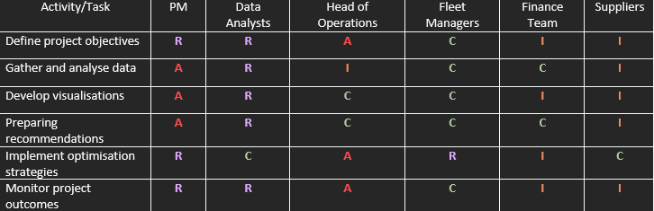
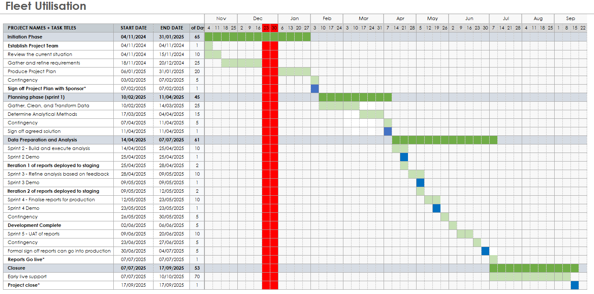
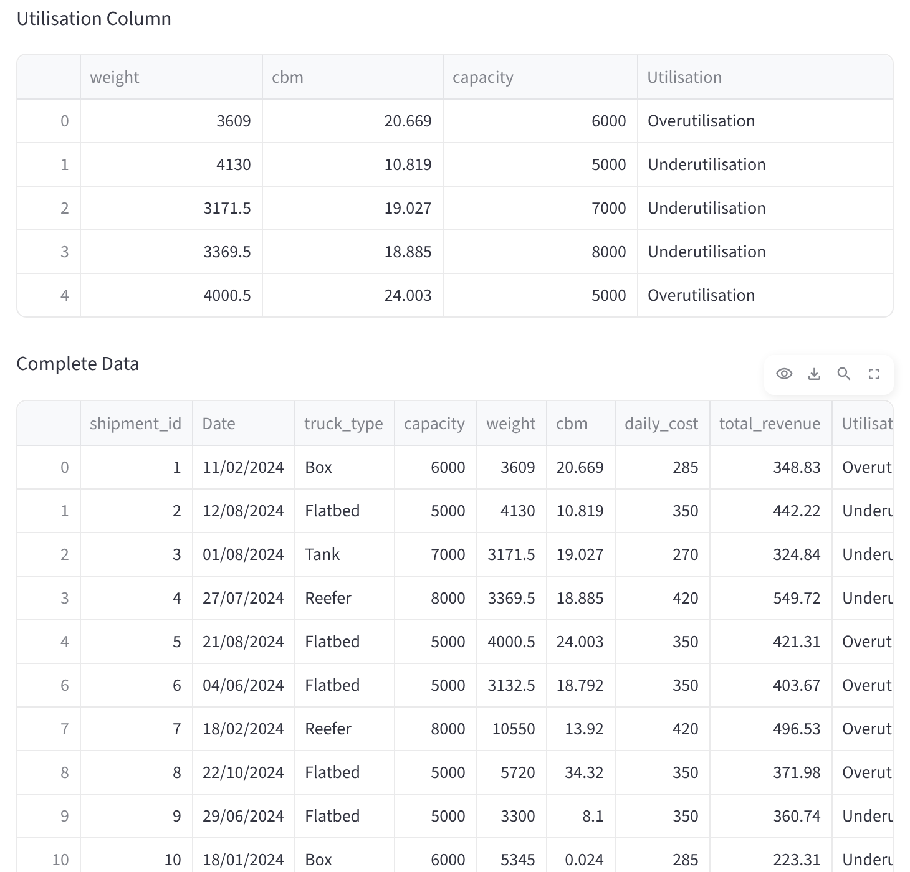
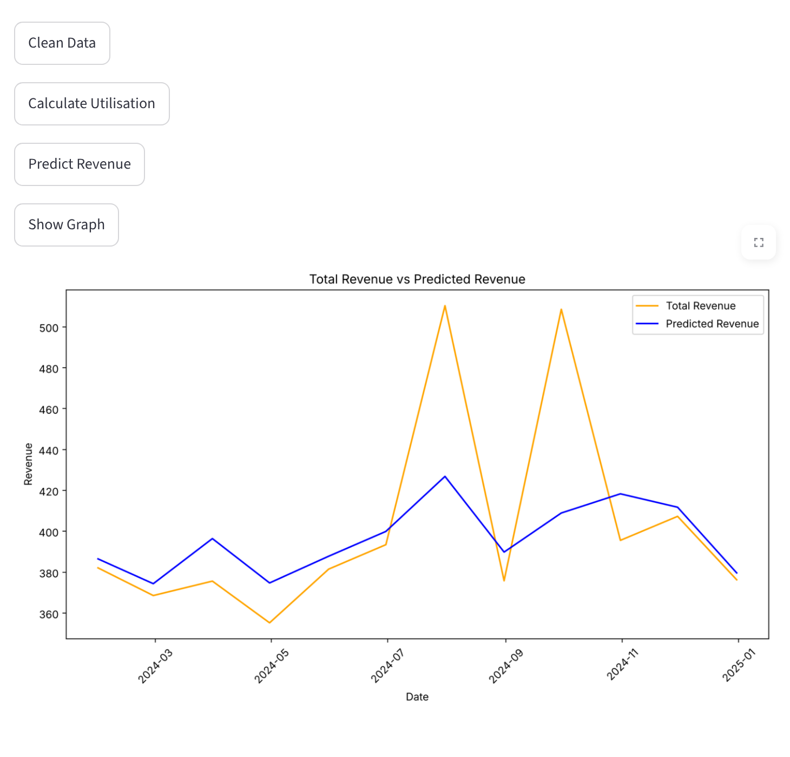

## At a glance

- **Problem:** Show how full each truck really is and forecast shipment revenue, without manual spreadsheets.
- **Data:** 407 synthetic shipments with weight, volume, truck capacity and running costs.
- **Approach:** A chargeable-weight utilisation rule, a linear regression revenue forecast, and a Streamlit web app for non-technical users.
- **Result:** 151 overutilised shipments identified, and a revenue error of about 75 against 114 for a simple average.
- **Tools:** Python, pandas, scikit-learn, Streamlit

---

## Why this project matters

Transport is one of the biggest costs in logistics, and every fleet faces the same question: is it cheaper to run our own trucks or to use a supplier? Answering it needs two things most teams work out by hand in spreadsheets: how full each truck really is, and whether each shipment earns more than it costs to run.

This project tackles both. It automates the utilisation check, adds a simple revenue forecast, and puts the whole workflow in a web app, so a non-technical user can upload a file and get answers without touching code.

  

    
  

---

## The business case

The project started as a plan, written before any code. The goal was to identify underused vehicles so the operations team could compare the cost of keeping each truck against using a supplier, with a target of a 15% improvement in fleet management within 12 months (figures in the plan were illustrative).

Scope was kept deliberately tight:

- **In scope:** how full each truck is against its capacity, and whether each vehicle earns more than its operating cost.
- **Out of scope:** driver performance, new customers and maintenance schedules.

The plan mapped stakeholders by power and interest, from the Head of Operations as sponsor to fleet managers, finance and suppliers, and set out who is responsible, accountable, consulted and informed at each stage.

  

    
  

Delivery was planned as a waterfall initiation phase followed by agile sprints, each ending in a demo so stakeholders could steer the work. Five weeks of contingency were built in, and the two highest risks, inaccurate data and stakeholder misalignment, each had a named owner and mitigation.

  

    
  

---

## Measuring utilisation properly

A truck can be full in two ways: by weight (dense goods like steel) or by space (light, bulky goods). Freight is charged on whichever is greater, known as the chargeable weight.

The app applies the same rule. It converts each shipment's volume into a volumetric weight using a common road-freight convention (1 cubic metre = 333 kg), takes the larger of that and the actual weight, and compares it with the truck's capacity. Each shipment is then labelled as under- or overutilised.

Using both measures matters. Of 407 shipments, 151 were overutilised, and for 159 shipments it was volume, not weight, that decided how full the truck was. A weight-only check would have missed many of them.

---

## Forecasting revenue

The second part of the app predicts each shipment's revenue from its capacity, weight, volume and daily running cost, using linear regression. Linear regression was chosen because it is transparent: each input has a single, readable effect on the prediction.

On held-out test data, the model is off by about 75 in revenue per shipment on average, compared with about 114 when every shipment is simply predicted at the average revenue. That is a useful improvement for a simple model. A handful of very large revenue values limit how closely any straight-line model can fit, and they are the first thing to investigate next.

---

## Delivering it as a web app

Analysis locked in a notebook only helps the person who wrote it. The app, built with Streamlit, walks the user through each step in order:

1. Upload a CSV of shipments
2. Clean the data (missing values filled, duplicate shipments removed)
3. Calculate utilisation
4. Predict revenue and see the model's error
5. Show a monthly chart of actual against predicted revenue

The buttons only appear once a file has been uploaded and cleaned, so the analysis always runs on prepared data.

  

    
    
  

---

## How the code is organised

The logic is split into small, single-purpose pieces, so the same code runs in the app, from the command line, or in a test:

- **`data_cleaner.py`**: the `DataCleaner` class fills missing values and removes duplicate shipments.
- **`fleet_analysis.py`**: the `FleetAnalysis` class calculates utilisation and trains the revenue model.
- **`main.py`**: runs the full pipeline from the command line.
- **`app.py`**: the Streamlit interface.
- **`test.py`**: checks the data before and after each step.

Because the two classes know nothing about Streamlit, the analysis can be reused or extended without touching the interface.

---

## Limitations

- **Synthetic data.** The dataset was created for learning. The workflow reflects real operations, but the results do not.
- **Simple model.** Linear regression is easy to explain but cannot capture more complex relationships, and a few extreme revenue values affect it.
- **One volumetric factor.** The 333 kg per cubic metre convention suits road freight; other modes or contracts would need their own factor.

---

## What this project demonstrates

Good analytics starts before the code: a clear business question, an agreed scope and a plan stakeholders can follow. This project carries that through to a working tool that applies a real freight rule, reports a clear measure of its accuracy and puts the results in the hands of the people who need them.

---

## View the code

The full code, data and app are on GitHub:

**[View the project on GitHub](https://github.com/jdimonaco/Streamlit-App-Truck-Utilisation-And-Revenue-Forecast)**
