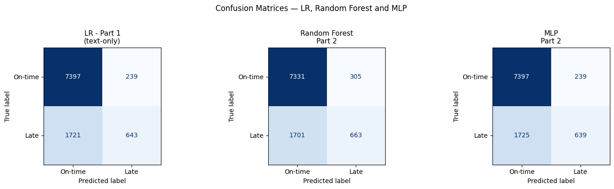
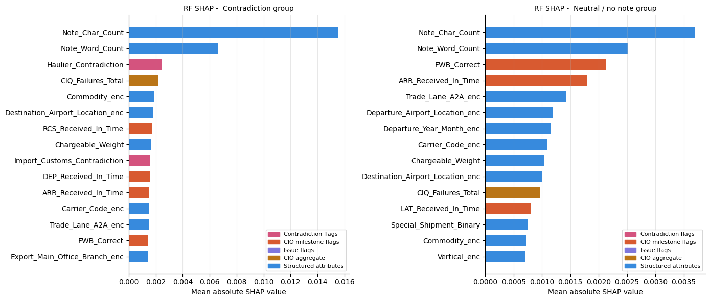
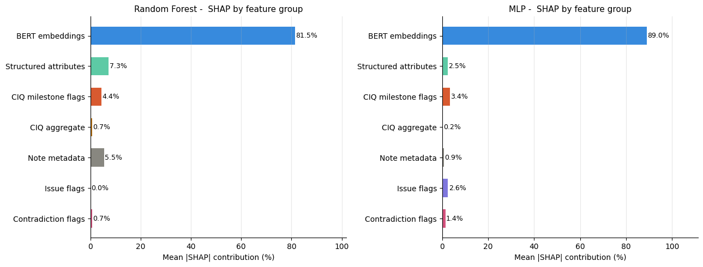

## At a glance

- **Problem:** Flag air cargo shipments likely to be delayed, using what staff write in handling notes.
- **Data:** 50,000 synthetic shipment records with free-text handling notes and Cargo iQ milestone flags.
- **Approach:** DistilBERT embeddings, rule-based issue flags and note-versus-milestone contradiction features, with three models compared on the same test set and explained with SHAP.
- **Result:** Shipments with a contradiction were late 37.9% of the time against 22.2% without, and the multimodal model's biggest gain was in exactly that group.
- **Tools:** Python, pandas, scikit-learn, PyTorch, Hugging Face Transformers, SHAP, Matplotlib

---

## Why this project matters

Air cargo shipments move through a chain of linked milestones: documentation, acceptance, departure, arrival and final availability. Structured Cargo iQ reporting tracks every step, but it is built to confirm what has already happened, not to flag what is about to go wrong.

Handling notes, the free-text comments staff leave on a shipment, often know earlier. A note like *"customs hold, paperwork incomplete"* can appear while every structured milestone flag still reads on time and correct. This project tests a simple idea: can the disagreement between what a note says and what the structured data says become an early-warning signal, helping a team decide which shipments deserve a second look before the delay happens?

This was the final project of my Level 6 Data Science degree apprenticeship, and it draws directly on my background in air cargo operations.

---

## The questions

The analysis was built around three research questions:

1. Do handling notes contain a measurable signal about delay risk on their own?
2. Do structured shipment attributes, Cargo iQ milestone flags and note-versus-milestone contradiction flags improve on that text-only baseline?
3. Does a more complex neural network outperform a simpler tree-based model when both see the same features?

The dataset is a synthetic set of 50,000 shipment records, built so the workflow could be tested end to end without touching live customer or operational data. A shipment is labelled late when its final notification milestone is recorded more than 30 minutes after the planned time, which applies to 23.6% of shipments. The milestone timestamps used to create that label were removed from the inputs, so the models cannot read the answer.

---

## Turning notes into features

The notes were used in two complementary ways:

- **DistilBERT embeddings** turn each note into a 768-dimension vector that captures its meaning, including phrasing no rule anticipated.
- **Rule-based issue flags** mark 13 interpretable categories, such as documentation, customs, temperature and damage, after expanding operational abbreviations like "fwb".

The key engineered feature is the **contradiction flag**: a note describes a problem linked to a specific milestone, while that milestone's structured flags still look clean. Nine of these flags were built, one for each milestone-linked issue type.

The signal was visible before any modelling. 4,487 shipments, about 9% of the dataset, had at least one contradiction, and 37.9% of them were late, against 22.2% of shipments without one.

---

## Three models, one test set

All three models were evaluated on the same 10,000 held-out shipments:

- **Text-only Logistic Regression**, with 781 features from the notes alone (768 DistilBERT dimensions plus 13 issue flags). Structured data was deliberately left out to isolate what the notes are worth.
- **Multimodal Random Forest**, with the full 821 features: the note features plus 14 shipment attributes, 12 Cargo iQ milestone flags, a milestone-failure count, 4 note metadata features (such as note length and issue count) and the 9 contradiction flags.
- **Multimodal MLP**, a 256-128-64 neural network on the same 821 features, to test whether extra complexity finds anything the Random Forest misses.

| Model | ROC-AUC | F1 | Precision | Recall | Accuracy |
|---|---|---|---|---|---|
| Logistic Regression, text only | 0.616 | 0.396 | 0.729 | 0.272 | 0.804 |
| Random Forest, multimodal | **0.628** | **0.398** | 0.685 | **0.281** | 0.799 |
| MLP, multimodal | 0.625 | 0.394 | 0.728 | 0.270 | 0.804 |

Adding structured and contradiction data lifted ROC-AUC from 0.616 to 0.628, a real but modest gain of 0.012. The Random Forest edged out the MLP, so the extra neural-network complexity added nothing on this feature set.

Recall is the most important number here, and the least flattering. Of the 2,364 late shipments in the test set, the models catch between 639 and 663. When they do raise a flag, they are right roughly 7 times out of 10. This is not a model to replace a human decision. It is a model to prioritise a review queue.

  

    
  

---

## The finding that justified the project: contradictions

The most useful result sits in a specific slice of the data. Breaking performance down by shipment group shows where the multimodal features help:

| Shipment group | Test shipments | Text only | Random Forest | MLP |
|---|---|---|---|---|
| Contradiction | 934 | 0.655 | **0.681** | 0.675 |
| Note and milestone agree on an issue | 1,383 | 0.803 | 0.808 | **0.810** |
| Issue not linked to a milestone | 559 | 0.524 | 0.511 | **0.544** |
| Neutral or no note | 7,124 | 0.495 | **0.513** | 0.509 |

*ROC-AUC by group; 0.5 is no better than chance.*

The contradiction group shows the largest gain over the text-only baseline (+0.026). Where notes describe a recorded milestone issue, all models do well. Where a note is neutral or missing, which covers most shipments, every model is close to chance, and this is where most of the missed delays sit.

The model explanations confirm the contradiction effect. For contradiction shipments, the Random Forest's top drivers include `Haulier_Contradiction` and `Import_Customs_Contradiction`, the exact flags built to catch a note disagreeing with a clean milestone. For neutral shipments, no contradiction flags appear; the model relies on note length, milestone flags such as `FWB_Correct` and arrival timeliness, and route attributes.

  

    
  

---

## What the model actually relies on

Across all shipments, SHAP shows that the meaning of the note carries most of the signal. DistilBERT embeddings account for 81.5% of the Random Forest's SHAP importance and 89.0% of the MLP's. Contradiction flags account for 0.7% and 1.4% respectively.

  

    
  

These two findings fit together. Contradiction flags only exist for 9% of shipments, so they cannot carry much weight overall, but where they apply, they are among the strongest interpretable drivers. Among the non-text features, the ones that matter most have a clear operational reading: longer notes usually mean more went wrong, and documentation correctness and arrival timeliness are the milestones an operations team would expect to see.

---

## Limitations

This is a proof of concept, not a production system:

- **Synthetic data.** The relationships and text patterns are simulated. The workflow is real, but real-world performance is not proven.
- **Low recall.** At around 27-28%, most delayed shipments go undetected at the default threshold. The model supports review rather than replacing it.
- **No proven lead time.** Without reliable note timestamps, the analysis cannot prove that each contradiction note was written before the milestone slipped, only that the two disagree.
- **Single train/test split.** Results come from one stratified split rather than repeated cross-validation or an out-of-time test.

The next steps are note timestamps to measure genuine warning lead time, an out-of-time evaluation, and decision thresholds calibrated to the real cost of a missed delay against an unnecessary review.

---

## What this project shows

- **Domain knowledge creates the best features.** The contradiction flag came from knowing how shipments go wrong in practice, not from the algorithm.
- **Simpler held its own.** The Random Forest matched the neural network, so the extra complexity was not justified.
- **Honest results build trust.** Low recall is reported plainly, and the model is positioned as a way to prioritise reviews, not to replace people.

---

## View the code

The full notebook, data and analysis are on GitHub:

**[View the project on GitHub](https://github.com/jdimonaco/Early-Warning-Model-for-Air-Cargo-Delays)**
