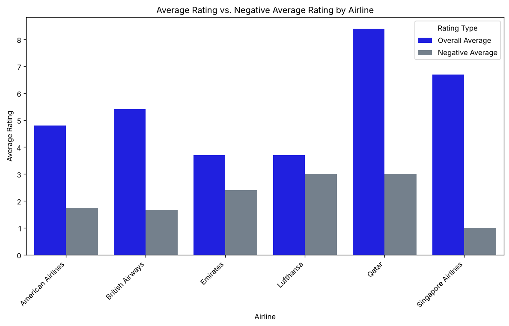
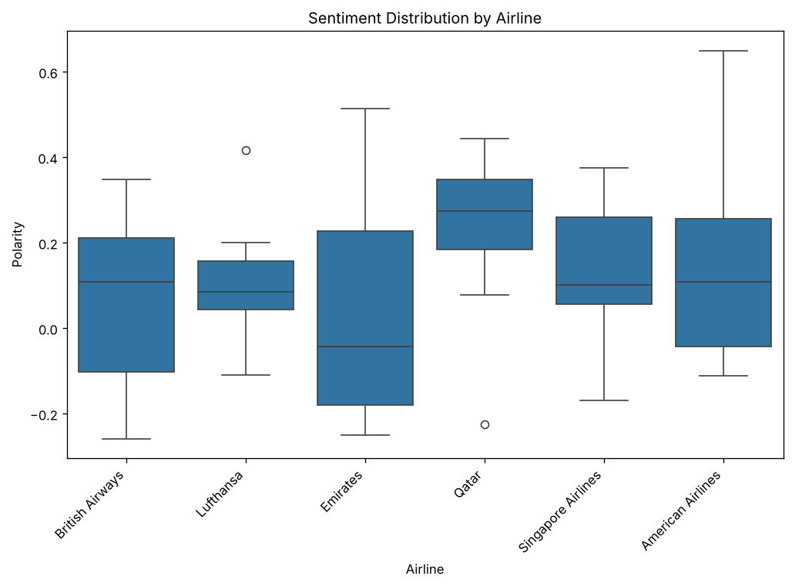
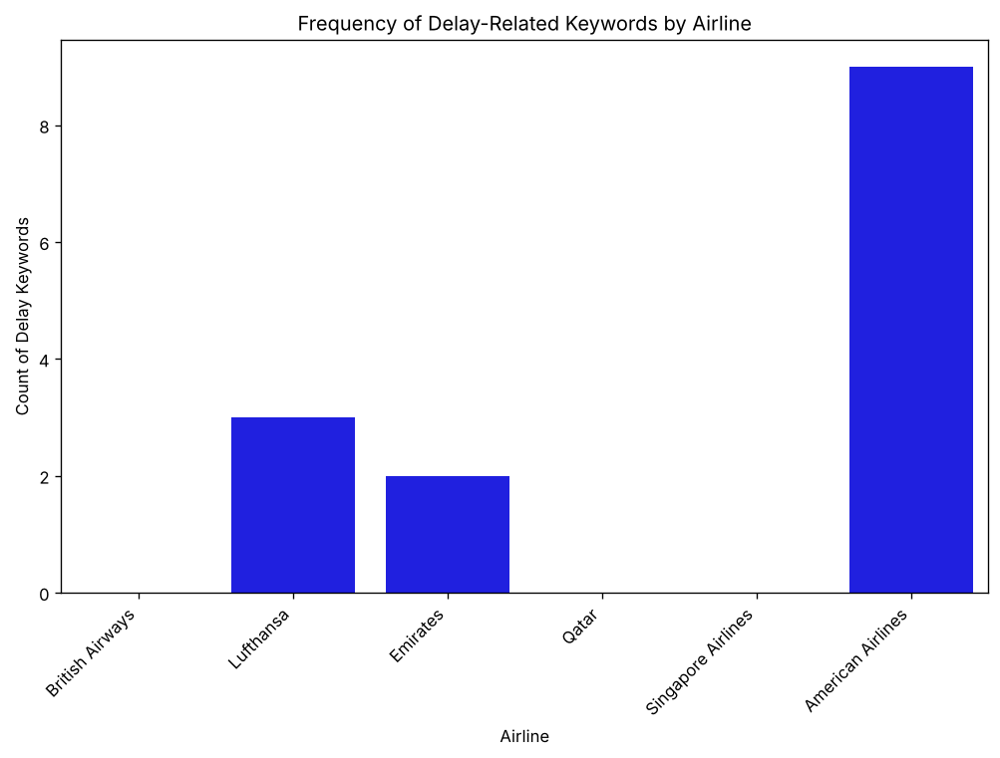
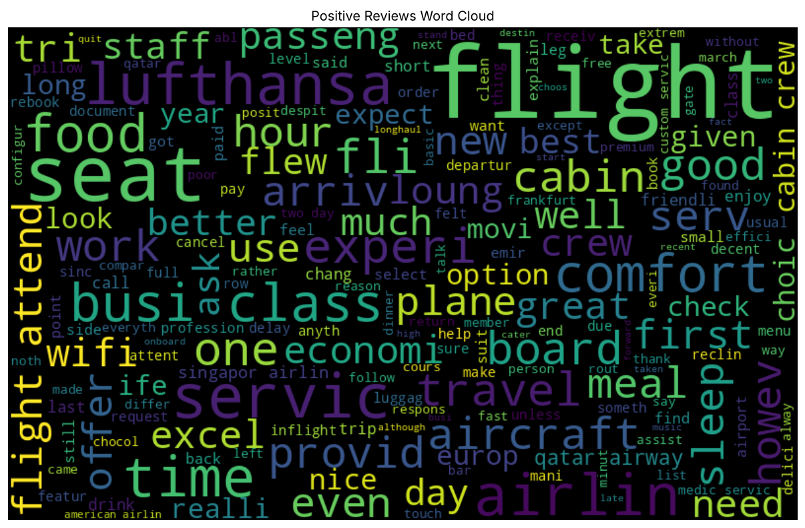
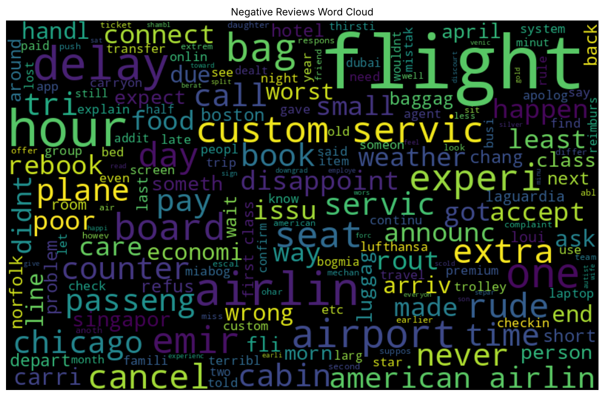

## At a glance

- **Problem:** Find which airlines show signs of disruption, using what passengers write in public reviews.
- **Data:** 60 recent reviews for six airlines, collected from a public review site.
- **Approach:** Web scraping, TextBlob sentiment, delay-keyword detection, word clouds and LDA topic modelling, in a modular Prefect pipeline.
- **Result:** Qatar had the most positive reviews (8.4 out of 10), and delay and cancellation words appeared most often for American Airlines.
- **Tools:** Python, requests, BeautifulSoup, TextBlob, NLTK, Prefect, Matplotlib, WordCloud

---

## Why this project matters

In air cargo, reliability is not a "nice to have". A single delayed or cancelled flight can cascade into missed connections, warehouse backlogs, customer complaints and contractual penalties. The challenge is that operational issues often surface only after performance has already slipped.

Passenger reviews offer an underused signal. They are messy, unstructured and subjective, but they show which airlines are associated with delays, where service breaks down, and what travellers mention first when things go wrong.

This project turns that unstructured feedback into something measurable, to support better-informed conversations with airline partners.

---

## The business problem

Cargo operations are judged on consistency: on-time delivery, predictable capacity and minimal disruption. Yet direct feedback from cargo customers is limited and often arrives too late to act on.

This project treats passenger reviews as a proxy for broader airline performance. The claim is not that passenger experience and cargo handling are identical, but that persistent operational disruption tends to affect both. The analysis was built to answer practical questions:

- Which airlines show signals of disruption and dissatisfaction?
- What themes appear when sentiment turns negative?
- How often are delays and cancellations mentioned, and for which airlines?

---

## From reviews to a performance signal

The pipeline collects the latest reviews for six airlines from a public review site (British Airways, Lufthansa, Emirates, Qatar, Singapore Airlines and American Airlines), after first checking the site's rules for automated access. The pages are saved locally, so the analysis can be rerun without returning to the site.

Each review then goes through four layers of analysis:

- **Sentiment:** TextBlob scores each review's polarity (negative to positive) and subjectivity, and labels it positive, negative or neutral.
- **Delay detection:** negative reviews are scanned for delay and cancellation keywords, counted per airline.
- **Word clouds:** the most frequent words in positive and negative reviews, after cleaning, stemming and lemmatisation.
- **Topic modelling:** LDA groups the reviews into recurring themes that explain why sentiment shifts.

---

## What the reviews revealed

The analysis covered 60 reviews, ten per airline. Overall, 73% were positive and 27% negative, and 80% came from verified trips.

The differences between airlines were clear. Qatar had the highest average rating (8.4 out of 10) and the most positive language, followed by Singapore Airlines (6.7). Emirates and Lufthansa had the lowest average rating (3.7), and half of Emirates' reviews were negative. Where reviews were negative, ratings dropped sharply for every airline.

  

    
  

The review text tells the same story as the star ratings. Qatar's reviews were consistently positive, while Emirates had the lowest typical score and the most negative language.

  

    
  

Delays were the clearest operational signal. Delay and cancellation words appeared most often in American Airlines' negative reviews (9 mentions), followed by Lufthansa (3) and Emirates (2), with none for British Airways, Qatar or Singapore Airlines.

  

    
  

The word clouds show what sits behind the scores. Positive reviews talk about seats, comfort, cabin crew, food and business class. Negative reviews are about delays, cancellations, rebooking, baggage, customer service and rude staff: exactly the kinds of breakdown that also affect cargo. (The words appear in their stemmed form, such as "servic" for service, because the text is cleaned before counting.)

  

    
    
  

Topic modelling grouped the reviews around seat comfort and cabin class, onboard service, and boarding and service issues.

With ten reviews per airline, these results are a first read, not a ranking. The value is that the same pipeline can be rerun on more reviews, more airlines or regular intervals to confirm the patterns.

---

## How the code is built

The project started as a single notebook and was refactored into a modular Python program, so each part of the workflow has one clear job:

- **check_robots.py** checks the site's rules for automated access
- **scraping.py** downloads each airline's review page and extracts the title, rating and review text
- **processing.py** gathers the reviews from the saved pages for every airline
- **storage.py** saves the reviews to a file and reloads them for analysis
- **nlp.py** cleans the text, scores sentiment and counts delay keywords
- **topic_modelling.py** finds the main themes with LDA
- **visualisations.py** produces the charts and word clouds
- **main.py** runs the whole pipeline in order as a Prefect flow

Because each step is separate, parts can change without rewriting the rest. For example, TextBlob could be replaced with a transformer model without touching the scraping or storage code, and new airlines can be added to a single list.

---

## Responsible data collection

The project only uses publicly available reviews. The site's rules were checked first, no personal information was collected, and the data is used for analysis only, not republished or monetised.

---

## Limitations and next steps

- **Small sample:** ten reviews per airline from a single collection. More reviews over time would show whether the patterns hold.
- **Simple sentiment model:** TextBlob scores individual words, so it can miss sarcasm and mixed reviews. A transformer model would read context better.
- **Proxy measure:** passenger reviews reflect cargo reliability only indirectly. Combining them with operational data, such as flight delay records, would make the signal stronger.

---

## What this project shows

- **Unstructured text can be measured.** Messy reviews became ratings, sentiment scores, delay counts and themes that can be compared across airlines.
- **Good structure makes analysis repeatable.** The modular pipeline can be rerun on more reviews or airlines without rewriting the code.
- **Responsible collection comes first.** The site's rules were checked before any data was collected.

---

## View the code

The full pipeline, data and notebook are on GitHub:

**[View the project on GitHub](https://github.com/jdimonaco/scrape-and-sentiment-airlines)**
