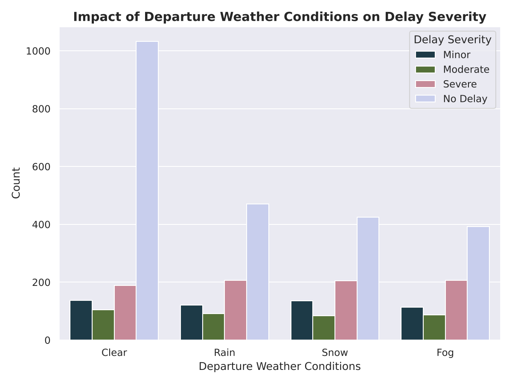
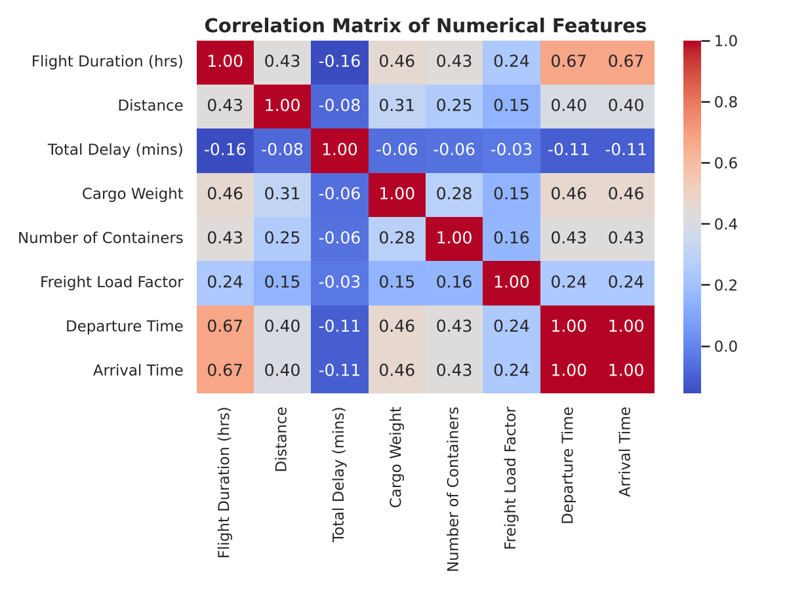
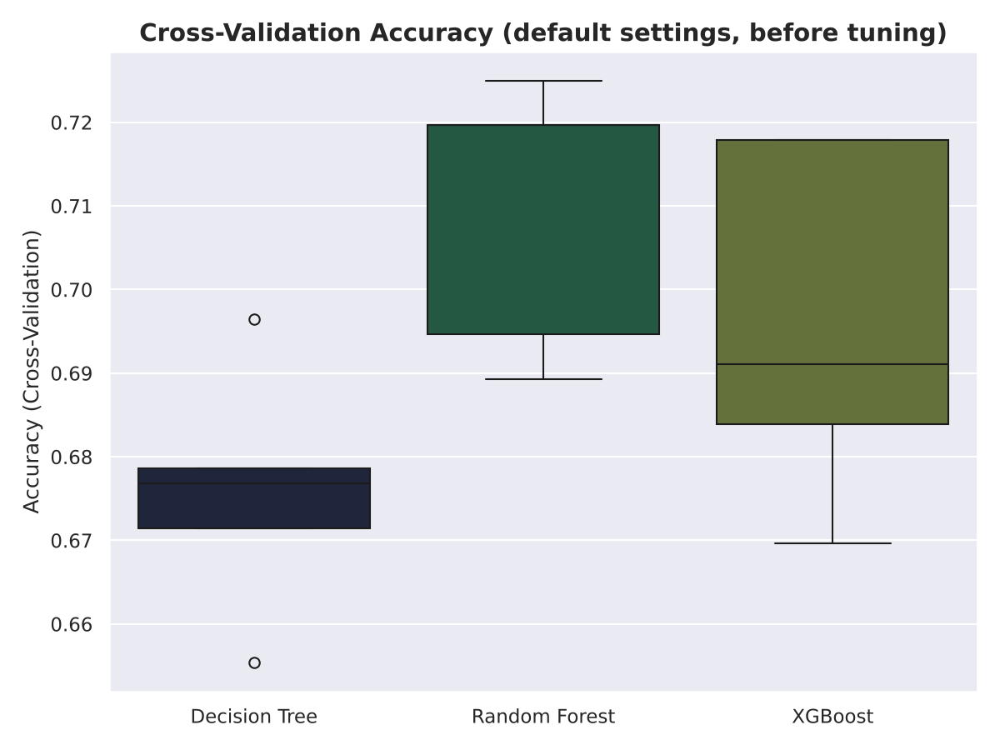
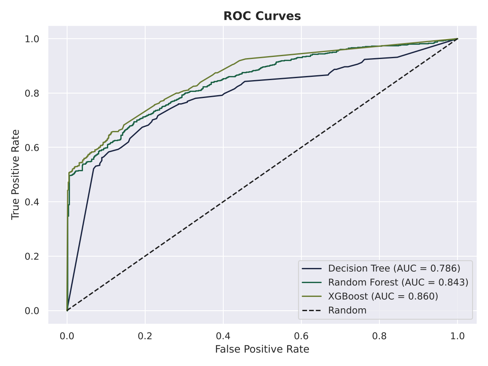
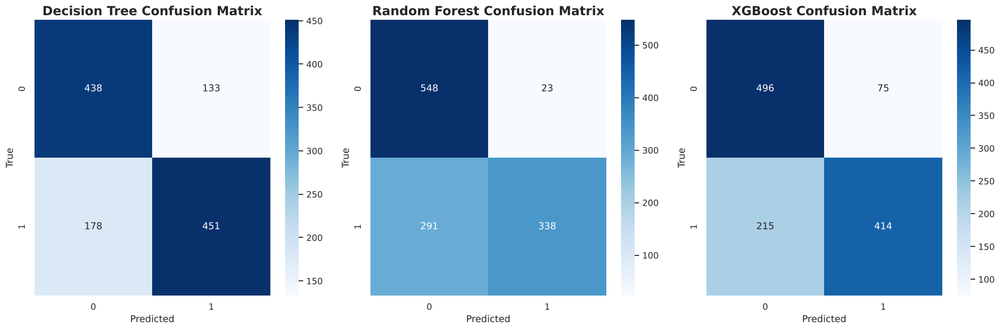
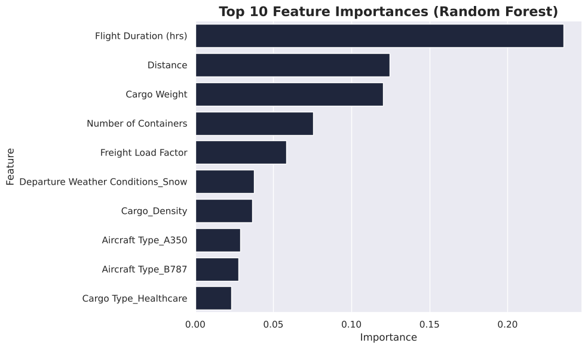

## At a glance

- **Problem:** Predict which cargo flights will be delayed, using only information known before departure.
- **Data:** 4,000 synthetic cargo flights with 19 fields, from route and cargo load to departure weather.
- **Approach:** Decision Tree, Random Forest and XGBoost, tuned with grid search and cross-validation, after finding and fixing data leakage.
- **Result:** 74–76% accuracy on unseen flights. Random Forest was chosen because 94% of the flights it flags are genuinely delayed.
- **Tools:** Python, pandas, scikit-learn, XGBoost, Matplotlib, Seaborn

---

## Why this project matters

My first model scored over 99% accuracy. That was the problem: no model predicts flight delays that well, and finding out why became the most valuable part of this project.

Flight delays create cascading disruption across airline operations, cargo logistics, staffing and customer commitments. The challenge is not simply predicting delays, but predicting them early enough, and explaining them clearly enough, for people to act on them: rebooking cargo, briefing ground handling, or warning customers before the problem reaches them.

This project explores how machine learning can support better operational judgement, not just better predictions. The emphasis is on choosing a model that fits real decision-making needs: clarity, reliability and the trust of the people who will use it.

---

## The data

The dataset covers **4,000 cargo flights** (synthetic data, with airline and airport identities anonymised) and 19 fields: route, aircraft type, distance, cargo weight and load factor, container count, cargo type, special handling and dangerous goods flags, peak season, and departure weather. The target is simple: was the flight delayed?

To reflect how operations actually work, I engineered additional features: planned flight duration, cargo density (weight per container), and departure hour, day and time-of-day bands taken from the planned schedule. Every feature had to be something known **before** the flight leaves, because that is when a prediction is useful.

---

## What the data pushed back on

The obvious hypothesis going in was that weather drives delays. The data told a more specific story. Poor weather roughly doubles the chance of a delay: 34% of flights in clear weather were delayed, compared with 67% in snow. But the number of **severe** delays (over an hour) barely moved, sitting between 188 and 207 flights whatever the conditions.

In other words, weather changes whether a flight is delayed at all, but it isn't what turns a delay into a severe one. Weather-based rules alone would be a poor predictor, which pointed the modelling towards features that capture operational load as well as conditions.

A correlation check reinforced the point. None of the numerical variables (flight duration, distance, cargo weight, container count, load factor) correlated strongly with delay on its own; every coefficient sat between -0.16 and -0.03. Delay comes from combinations of conditions, which is exactly what tree-based models are designed to learn.

  

    
    
  

---

## A progressive modelling approach

Rather than treating model selection as a one-step decision, I built up in stages, with each model answering a specific question.

**Stage 1: Decision Tree, for understanding.** Which combinations of features separate delayed flights from on-time ones, and do they match operational intuition? The baseline tree reached 69% accuracy, rising to 74% once its depth was limited, confirming that pre-departure information carries a genuine signal.

**Stage 2: Random Forest, for reliability.** Does combining many trees make predictions more stable? Averaging many trees lifted cross-validation accuracy above the single tree's (0.71 against 0.68 before tuning), and the tuned forest became the most precise model of the three.

**Stage 3: XGBoost, for the performance ceiling.** How much more can be gained, and at what cost? Tuned with shallow trees and a slow learning rate, it achieved the highest accuracy and ROC-AUC.

All three were tuned with grid search and five-fold cross-validation, then tested on the same 1,200 held-out flights.

---

## Results

| Model | Accuracy | Precision | Recall | F1 | ROC-AUC |
|---|---|---|---|---|---|
| Decision Tree | 0.741 | 0.772 | 0.717 | 0.744 | 0.786 |
| **Random Forest** | 0.738 | **0.936** | 0.537 | 0.683 | 0.843 |
| XGBoost | **0.758** | 0.847 | 0.658 | 0.741 | **0.860** |

The three models land within about two percentage points of each other on accuracy. The real differences are in **how** they make mistakes. The confusion matrices show it clearly: the Decision Tree catches the most delays (451 of 629) but raises the most false alarms (133), while the Random Forest raises only 23 false alarms but misses 291 delays. XGBoost sits in between.

  

    
    
  

  

    
  

---

## Why Random Forest was chosen

XGBoost scored highest, but **Random Forest was selected** as the final model. The decision reflects what the prediction is for, not just which number is biggest.

- **Explainability for stakeholders.** Random Forest's feature importance gives a clear, intuitive answer to "why was this flight flagged?", which builds trust with operational teams and supports conversations about prevention and contingency planning.
- **Proportionate to the problem.** With 4,000 flights, the extra tuning effort and complexity of gradient boosting is hard to justify. Random Forest performed well with modest tuning and is simple to retrain and maintain.
- **Alerts people can act on.** 94% of the flights it flags are genuinely delayed. When it raises an alert, it is almost always right.
- **A small trade-off.** It gives up about 2 points of accuracy and 0.02 of ROC-AUC compared with XGBoost.

The drivers it found are ones an operations team would recognise: planned flight duration matters most, followed by distance, cargo weight, container count and load factor, with snow the strongest weather signal.

  

    
  

The honest trade-off is recall: at the default threshold, the model catches around half of delayed flights. Because its ROC-AUC is strong, the threshold can be lowered to catch more delays at the cost of more alerts. That decision belongs to the people who carry the cost of each type of error, and the model makes it easy to have that conversation.

---

## What evaluation caught

The first version of this project reported accuracy above 99% for every model. Three different models all scoring above 99% is a warning sign, not a win. The cause was **data leakage**: some inputs contained information that is only known after a delay has happened.

- `Total Delay (mins)` (actual arrival minus planned arrival) was being used as a model input. It only exists once the flight has landed, so the models were reading the answer rather than predicting it. It is now used for exploratory analysis only.
- Departure hour, day of week and time of day were taken from the actual departure time, which already reflects any delay. They now come from the planned schedule.

With both removed and every model re-run, accuracy settled at a realistic 74% to 76%. The results above are the corrected ones, and the modelling approach and the reasoning behind the final choice stayed the same.

---

## Limitations

- **Synthetic, coursework-scale data.** The dataset is realistic in structure but small, so the results are a proof of method, not a production benchmark.
- **Single train/test split.** Results come from one 70/30 split plus cross-validation, not an out-of-time test on later flights.
- **Missing real-time signals.** En-route weather, airport congestion and handling milestones would likely improve recall.

---

## What this project demonstrates

Model choice is a strategic decision, not just a technical one. The best model is the one people can understand, trust and act on, and evaluation isn't finished when a score comes back. The most valuable check in this project was noticing that the first results were too good to be true, finding out why, and rebuilding them properly.

---

## View the code

The full notebook, including the corrected results and a note on the leakage fix, is on GitHub:

**[View the project on GitHub](https://github.com/jdimonaco/flight-delay-prediction)**
