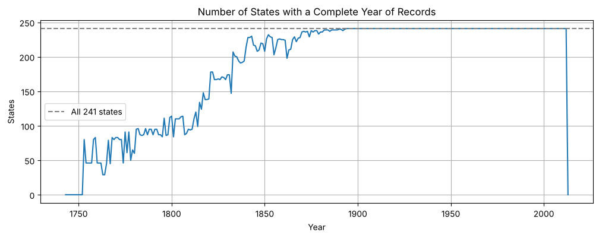
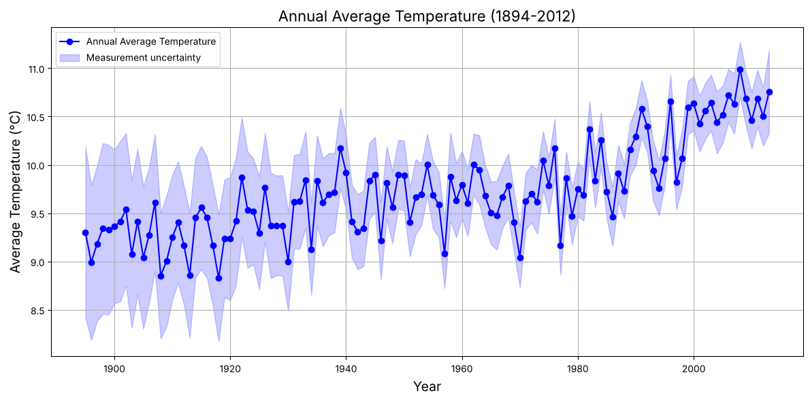
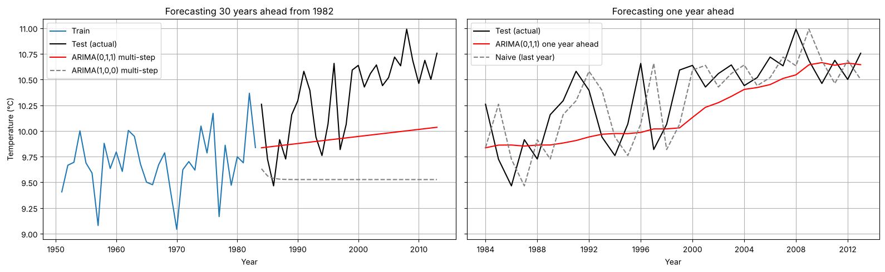
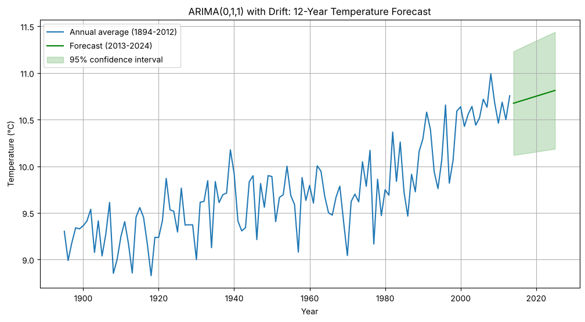

## At a glance

- **Problem:** Measure how fast land temperatures are rising, and how far ahead ARIMA can forecast them.
- **Data:** Berkeley Earth monthly temperatures for 241 states and provinces in seven countries, 1894 to 2012.
- **Approach:** Stationarity testing, AIC model selection on training years only, and 30-year and one-year-ahead tests on unseen years.
- **Result:** Warming of 0.28°C per decade since 1970, and a one-year-ahead error of 0.25°C, better than a naive forecast.
- **Tools:** Python, pandas, NumPy, statsmodels, scikit-learn, Matplotlib, Seaborn

---

## Why this project matters

Earth's surface temperature is rising. The harder questions are how fast, whether the pace is changing, and how far ahead a statistical model can see before it stops being useful. This project uses more than a century of land temperature records to measure the warming trend, build an ARIMA forecast, and then test that forecast against years the model has never seen.

---

## The data, and why the period matters

The data comes from Berkeley Earth's land temperature records, via Kaggle: monthly average temperatures for 241 states and provinces in seven countries (Australia, Brazil, Canada, China, India, Russia and the United States), from 1743 to 2013.

A long record is tempting, but the early years cover far fewer places. Only 80 states have records in the 1740s, and all 241 only have complete records from 1894. Averaging over a changing set of states creates false trends, because adding warmer or colder regions moves the average even when no temperature has changed. 2013 is also incomplete, ending in September, which would make that year look warmer than it was.

  

    
  

The analysis therefore uses **1894 to 2012**, the 119 years in which every state has all twelve months recorded. Each month is averaged across the 241 states, and the months are averaged into one value per year.

---

## What the record shows

Over those 119 years, the average temperature across the 241 states rose from 9.3°C in the 1890s to 10.6°C in the 2000s. The rise was not steady: the temperature was broadly flat until the 1920s, rose slightly until the 1940s, levelled off until the 1970s, and then climbed quickly. Warming averaged 0.11°C per decade over the whole period, but 0.28°C per decade from 1970 to 2012. The warmest year in the series is 2007.

  

    
  

The shaded band is the measurement uncertainty recorded in the dataset. It narrows from about ±0.9°C to ±0.4°C as recording methods improved, and the warming since the 1970s is far larger than that uncertainty.

---

## Building the model

ARIMA needs a stationary series: one whose average does not drift over time. A Dickey-Fuller test confirmed the annual temperatures are not stationary (p = 0.99), as the rising trend suggests. Once each year is expressed as the change from the year before, the series becomes stationary, so the model uses one round of differencing.

To keep the evaluation fair, the data was split in time order. The model learns from 1894 to 1982, and the 30 years from 1983 to 2012 are held back as a test. Every modelling choice was made on the training years only: 64 candidate models were compared on AIC, and the best was **ARIMA(0,1,1) with drift**, where the drift is the average yearly change the model carries forward (about 0.007°C a year in the training period). Its residuals behave like random noise, with no pattern left to capture.

---

## How well does it forecast?

The model was tested in two ways. First, forecasting all 30 test years at once from 1982. Second, forecasting one year at a time, with each year's actual value added before predicting the next.

  

    
  

| Approach | Average error |
|---|---|
| ARIMA(1,0,0), 30 years ahead | 0.81°C |
| Linear trend, 30 years ahead | 0.46°C |
| ARIMA(0,1,1) with drift, 30 years ahead | 0.46°C |
| "Same as last year", one year ahead | 0.29°C |
| **ARIMA(0,1,1) with drift, one year ahead** | **0.25°C** |

*Mean absolute error on the unseen years 1983 to 2012.*

The first model tried, ARIMA(1,0,0), treats the series as stationary, so its forecast drifts back to the old average and stays flat while the real temperature keeps rising. Adding differencing and drift almost halves the error. Even so, the 30-year forecast sits below the actual values in the later years, because warming sped up after the training period: the model learned a rate of about 0.07°C per decade, while the test years warmed far faster.

One year ahead, the model performs well. It is off by 0.25°C on average, better than simply assuming next year will match this year.

---

## Looking ahead

Refitted on all 119 years, the model forecasts the average temperature to continue rising, from about 10.7°C in 2013 to 10.8°C in 2024, with the uncertainty widening the further ahead it looks.

  

    
  

Given the test results, this forecast is best read as a cautious baseline. It extends the long-run rate of warming, while the recent rate has been considerably faster.

---

## What this project shows

- **The period matters as much as the model.** Checking which states were recording, and when, avoided false trends that a longer but inconsistent record would have produced.
- **Testing on unseen years changes the conclusion.** A model can match the past closely and still under-predict the future; only a fair test shows the difference.
- **ARIMA is a good short-term forecaster, not a climate projection tool.** A model that only learns from past temperatures cannot anticipate a change in the rate of warming.

---

## Limitations and next steps

- **Not a global average:** this is an average of 241 states in seven countries, and a plain average over-represents countries with many small states. Weighting by land area would be more representative.
- **Temperature history only:** adding drivers such as CO2 concentrations (for example, an ARIMAX model) would let the forecast respond to the causes of warming.
- **A fixed trend:** models that allow the rate of warming to change over time could capture the acceleration since the 1970s.

---

## View the code

The full notebook and analysis are on GitHub:

**[View the project on GitHub](https://github.com/jdimonaco/Time-Serie-Analysis-ARIMA)**
