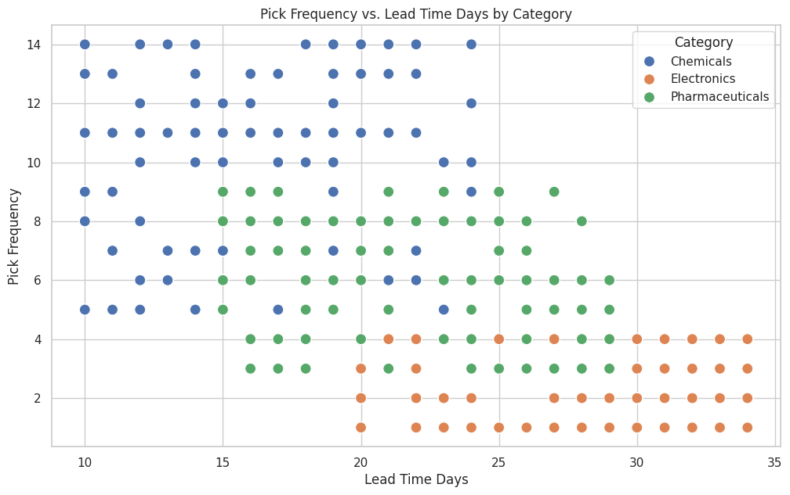
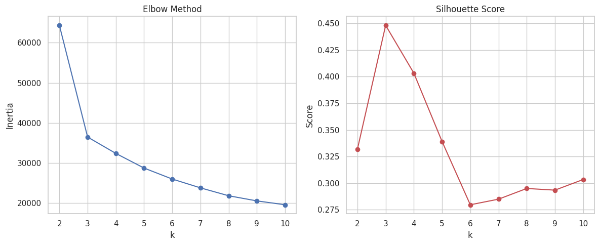
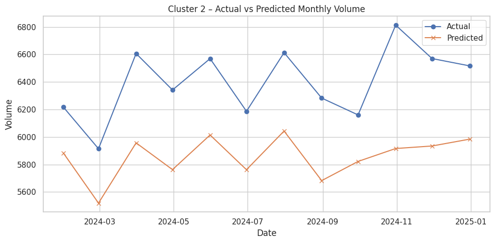
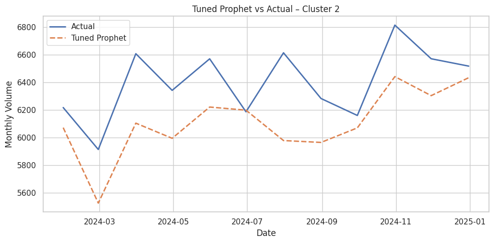

## At a glance

- **Problem:** Plan warehouse space and inbound volume from evidence rather than intuition.
- **Data:** 52 staff comments, plus synthetic product records and monthly inbound volumes from 2020 to 2024.
- **Approach:** VADER sentiment on staff feedback, K-Means clustering on product behaviour, and SARIMAX and Prophet forecasts for each cluster.
- **Result:** Three clear product groups, each forecast within about 5% error against a 15% target.
- **Tools:** Python, pandas, scikit-learn, NLTK VADER, statsmodels, Prophet, Matplotlib, Seaborn

---

## Why this project matters

Ask warehouse staff what slows them down and storage comes up first. This project started there, with what people on the floor said, before looking at a single product record.

Warehouse operations sit at the heart of supply chains, yet many warehouses still plan reactively when managing space, stock and labour. Small inefficiencies compound quickly: picking slows down, storage layouts drift out of line with demand, and teams end up responding to problems instead of anticipating them.

This project set out to move warehouse decisions from intuition to evidence, while staying practical enough to implement without new systems. It answers two questions:

1. Can products be grouped by how they behave in the warehouse?
2. Can inbound volume be forecast reliably for each group?

---

## Starting with the people on the floor

Before analysing any operational data, I analysed staff feedback using VADER sentiment analysis, which suits short, opinion-based comments. The aim was to find out which problems people felt most strongly about, so the analysis would focus on real pain points rather than abstract optimisation.

Of 52 comments, storage issues were the joint most common category (17 comments) and among the most negative. Picking delays also came through clearly. Forecasting gaps scored the most negative of all, but that came from a single comment, so I treated it as a signal to explore rather than a finding.

---

## Grouping products by behaviour

Warehouses manage thousands of products, and treating them all the same leads to inefficient layouts and wasted effort. A simple pick frequency against lead time plot showed the pattern before any modelling: fast-moving stock with short lead times in one corner, slow-moving stock with long lead times in the other, and a middle band in between.

  

    
  

I then used K-Means clustering on operational behaviour only: volume, weight, price, storage cost, pick frequency, lead time and seasonality. I deliberately left out product category and dates, so the clusters would describe how products behave rather than repeat their label. Both the elbow and the silhouette score pointed clearly to three clusters.

  

    
  

The most interesting result: without being told the category, the three behavioural clusters matched the product categories for **99.2%** of products. Each category behaves distinctly in this warehouse, which gives a solid basis for category-level storage rules.

| Cluster | Pick frequency | Weight | Price | Lead time | Storage recommendation |
|---|---|---|---|---|---|
| **Fast-Moving Chemicals** | 9.0 | 12 kg | £88 | 18 days | High-access zones near picking and packing |
| **Slow-Moving Heavy Electronics** | 2.7 | 84 kg | £166 | 28 days | Bulk storage with heavy-load racking |
| **High-Value Pharmaceuticals** | 6.4 | 53 kg | £234 | 22 days | Secure, moderately accessible zones with capacity for volume |

Pharmaceuticals add a useful nuance: they are picked only moderately often but carry the highest value and volume, so they deserve priority handling even though a frequency-only rule would place them in the middle.

---

## Forecasting volume for each cluster

Forecasting individual products is noisy, so I forecast monthly inbound volume at cluster level, which balances detail with stability. For each cluster I compared three models, all trained on 2020–2023 and tested on the unseen 2024 data:

- **SARIMAX**, tuned with a grid search over seasonal and non-seasonal settings
- **Prophet** with default settings
- **Prophet, tuned** with cross-validation on the training years only

| Cluster | SARIMAX | Prophet | Prophet (tuned) | Best model |
|---|---|---|---|---|
| Fast-Moving Chemicals | 4.87% | 5.00% | **4.05%** | Prophet (tuned) |
| Slow-Moving Heavy Electronics | **4.61%** | 4.96% | 5.04% | SARIMAX |
| High-Value Pharmaceuticals | 8.42% | **4.53%** | 4.53% | Prophet |

*Forecast error (MAPE) on 2024; lower is better.*

The clearest difference was in Pharmaceuticals. Their volumes fell until 2022 and then climbed steadily, reaching a new high in 2024. SARIMAX extended the recovery too cautiously and sat below the actuals all year (8.4% error). Prophet's more flexible trend followed the upturn much more closely (4.5%).

  

    
    
  

For the other two clusters, the models were close. Chemicals have a strong, repeating annual pattern with a sharp drop every December, which every model captured; tuning Prophet gave the best result. Electronics have a regular seasonal cycle, where SARIMAX was slightly more accurate.

The practical takeaway isn't "Prophet beats SARIMAX". Clusters behave differently enough that the forecasting method should be matched to each one and reviewed as new data arrives. With the best model per cluster, every group can be forecast within about 5%, well inside the 15% target.

---

## What evaluation caught

An earlier version of this analysis reported tuned Prophet errors of just 1–2%. A review showed the tuned models had been trained on data that included the 2024 test year, so they had already seen the answers. After retraining them on 2020–2023 only, the honest errors were 4–5%, and the conclusion changed from "SARIMAX is the most consistent model" to a per-cluster choice.

The same review found that the clustering had included product category and dates as inputs, which is why I rebuilt it on behaviour alone. The fact that the clusters still matched the categories made the result stronger, not weaker.

---

## Recommendations

- **Redesign the layout around the clusters:** fast movers near picking and packing, heavy slow movers in bulk storage, and high-value items in secure zones.
- **Use the best model per cluster** for monthly volume planning: Prophet for Chemicals and Pharmaceuticals, SARIMAX for Electronics.
- **Feed forecasts into staffing and equipment scheduling**, and review the model choice each year.
- **Keep stakeholders involved** to refine KPIs as the changes bed in.

---

## Limitations

- **Synthetic data:** realistic in structure, but the results are a proof of method rather than a production benchmark.
- **Short history:** 60 months per cluster, with a single 12-month test period.
- **External drivers not modelled:** promotions, supplier changes and other outside factors.

---

## What this project demonstrates

Effective data work isn't about using the most advanced model. It's about choosing the right level of sophistication for each part of the problem, connecting what staff experience on the floor to what the data shows, and checking results rigorously enough to trust them.

---

## View the code

The full notebook, data and corrected results are on GitHub:

**[View the project on GitHub](https://github.com/jdimonaco/warehouse-clustering-forecasting)**
